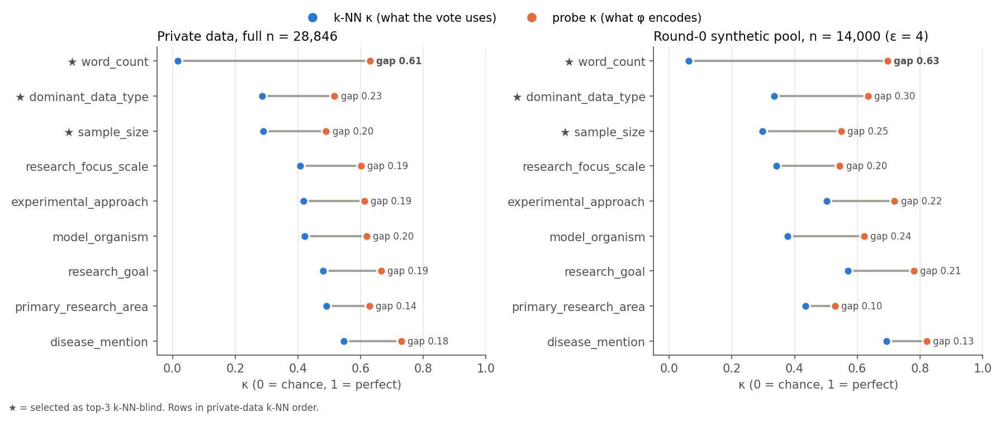
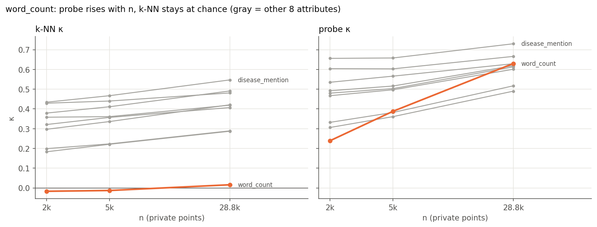
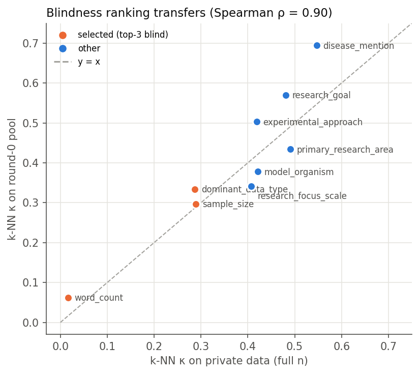
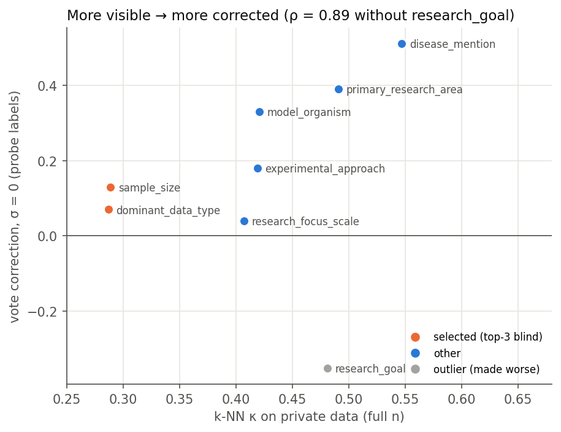
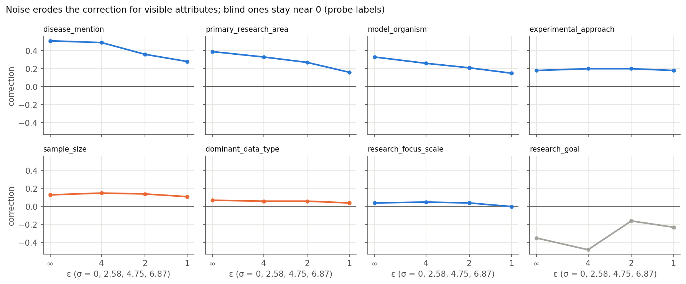
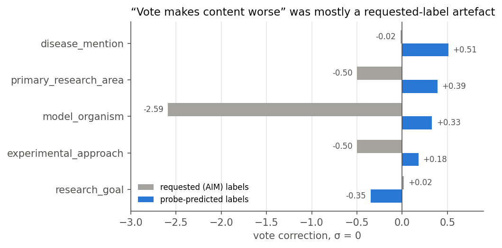

# Experiment 1: k-NN blindness vs. linear probe

Repo: git@github.com:KayorKando/PE-metadata.git (local: ~/Desktop/PE-metadata). First commit 55364fa, 2026-10-05. Venv setup added in f7a3c23. Round-0 generation script added in 4c99250.

Figures: `plot_exp1.py` (repo root) redraws all charts below from the numbers in this doc → `figures/exp1/*.png`. Paths in the image links are relative to the repo.

## Facts from the MAPLE code (github.com/elichien-google/MAPLE)
- Vote embedding φ = sentence-t5-base, `max_seq_length = 1024` (the `--emb_dim` flag sets this), L2 distance, 1-NN voting (`Voting_histogram`, `num_nearest_neighbors=1`), selection `mode='rank'` (top-K).
- MAUVE also uses sentence-t5-base.
- The bioRxiv data ships with Gemini labels in `biorxiv/biorxiv_train_metadata.csv` (28,846 rows). Off-schema values are common, e.g. `primary_research_area` has 81 distinct values against 28 options in the schema.
- word_count is binned as `round(words/50)*50`, the same as MAPLE's JSD evaluation.
- Round 0 (`MAPLE.py`): sample 2000 × 7 rows of AIM metadata → `RANDOM_API` (Qwen2.5-7B, metadata-conditioned few-shot prompt) → 1-NN vote on private data → top 2000 → saved as `PE_iter_0.csv`. The pre-vote pool is not saved by MAPLE.

## Design
- Two scores, each on a kappa scale (0 = chance, 1 = perfect).
  - k-NN visibility: k = 5, share of the 5 neighbors with the same label (no majority vote, so no ties), chance level = Σp².
  - Probe visibility: logistic-regression probe (StandardScaler + LR, C = 1, max_iter 2000), Cohen's kappa.
- Both scores use the same random half/half splits (20 repeats; 5 at full n), so they can be compared pair by pair.
- The top 3 attributes by k-NN blindness are selected.
- Toy test passes on the cluster (2026-10-09): `absent` ≈ 0 / ≈ 0, `quiet` k-NN ≈ 0 / probe ≈ 0.99, `loud` 0.94 / 0.99.

## Cluster setup (2026-10-09)
- GPUs 1 and 2 borrowed (GPU 0 is used by someone else). Driver 595.71 / CUDA 13.2, torch cu128 build.
- venv at `/data/$USER/envs/pe-metadata`; `PE_DATA=/data/$USER/PE-metadata`, `HF_HOME=/data/$USER/hf_cache`.
- GPU 1: n = 2000 then n = 5000 (20 repeats). GPU 2: n = all (28,846), 5 repeats.

## Results on private data (2026-10-09, all three runs done)
Assumed table order from the pasted output: n 2000, n 5000, then full n. Cell format: k-NN κ / probe κ.

| attribute | classes (2k/5k/full) | n = 2000 | n = 5000 | full n = 28,846 | gap (full) |
|---|---|---|---|---|---|
| word_count | 13 / 14 / 19 | −0.017 / 0.239 | −0.013 / 0.388 | 0.016 / 0.630 | **0.614** |
| dominant_data_type | 12 | 0.183 / 0.332 | 0.221 / 0.382 | 0.287 / 0.517 | 0.230 |
| sample_size | 6 | 0.199 / 0.306 | 0.223 / 0.361 | 0.289 / 0.490 | 0.201 |
| research_focus_scale | 9 | 0.321 / 0.467 | 0.357 / 0.497 | 0.407 / 0.601 | 0.194 |
| experimental_approach | 8 / 8 / 9 | 0.358 / 0.480 | 0.361 / 0.503 | 0.419 / 0.613 | 0.193 |
| model_organism | 17 | 0.297 / 0.492 | 0.336 / 0.516 | 0.421 / 0.619 | 0.198 |
| research_goal | 8 | 0.429 / 0.604 | 0.440 / 0.603 | 0.481 / 0.666 | 0.185 |
| primary_research_area | 27 | 0.379 / 0.535 | 0.411 / 0.566 | 0.491 / 0.629 | 0.139 |
| disease_mention | 10 | 0.434 / 0.656 | 0.467 / 0.658 | 0.547 / 0.730 | 0.183 |

Rows are in full-n k-NN-blindness order. sd of every κ ≤ 0.026 (≤ 0.007 at full n).

Spearman ρ (k-NN vs probe, across the 9 attributes): 0.933 (2k), 0.883 (5k), 0.600 (full, p = 0.088).
Without word_count, full n: ρ ≈ 0.95 (computed by hand from the table; 8 attributes).

Selected at all three n: **word_count, dominant_data_type, sample_size**.

*Fig 1. Blue = k-NN κ (what the vote can use), orange = probe κ (what φ encodes); the gray bar is the gap. word_count has by far the largest gap on both data sets. ★ = selected.*

*Fig 2. As n grows, word_count's probe κ climbs from 0.24 to 0.63 while its k-NN κ stays at chance. Other attributes (gray) rise slowly in both.*

## Findings
1. **Selection is stable across n.** The top 3 and the bottom (disease_mention) are the same at 2k, 5k and full n. At full n only the middle reshuffles: model_organism moves from 4th to 6th, and research_goal / primary_research_area swap. Those k-NN κ values differ by ≤ 0.014, so the reshuffle is minor.
2. **No attribute is well seen by the vote.** Even with all 28,846 points, the highest k-NN κ is 0.55 (disease_mention).
3. **word_count: φ encodes length well, but 5-NN ignores it completely.** The probe rises 0.24 → 0.39 → 0.63 with more training data, yet k-NN stays at chance (0.016) even at full density. The gap (0.61) is about 3× any other attribute's. This is the strongest "encoded but drowned by other directions" case and where a quota should help most.
4. **The full-n drop in ρ (0.60) comes from word_count alone.** Its probe κ is now mid-pack while its k-NN κ is lowest. Without it, ρ ≈ 0.95: for the other 8 attributes, what the vote can use tracks what φ encodes.
5. **dominant_data_type and sample_size are "weakly encoded" cases.** Lowest probe κ of all (≈ 0.49–0.52 at full n) and k-NN ≈ 0.29. A quota can fix their marginal distribution but cannot rank well within a cell.
6. **The other 8 have a near-uniform gap of 0.14–0.23**, growing slightly with n: the probe gains more from extra training data than k-NN gains from density. This is a general "neighbors use less than φ holds" penalty, not attribute-specific blindness.
7. **Probe κ has not saturated** (still rising from 5k to full n for every attribute), so probe κ is a lower bound on what φ encodes.

## Caveats
- word_count bins are ordinal, but both κ scores treat them as nominal (an off-by-one bin counts as fully wrong), so both understate how much length φ sees. A probe that regresses length (Spearman / MAE) would measure it better. This does not explain k-NN ≈ 0, though, because the same nominal scoring gives the probe 0.63.
- Gemini labels are noisy and off-schema values are mapped to `Other`; this caps both scores, more for attributes with many classes.
- The two chance corrections differ (Σp² vs. Cohen's kappa), so gap sizes are only roughly comparable across attributes.
- Non-private diagnostic on private data. The real method selects on the round-0 synthetic pool (post-processing).

## Practical note
word_count can be computed directly from the text, with no LLM labeling and no privacy cost on synthetic samples, so it is the cheapest quota attribute to deploy.

## Round-0 synthetic pool run (setup)
- `gen_round0.py` reuses MAPLE's prompt and `RANDOM_API` and saves the pool **before** the vote. MAPLE's `PE_iter_0.csv` is after the 1-NN vote on private data and top-K, so it touches private data and is already filtered by φ; it is not used.
- MAPLE defaults: Qwen2.5-7B-Instruct, 10 of 50 in-context examples (validation rows 0–49) per prompt, temperature 1.0, top_p 0.95, max_tokens 1024, pool = 2000 × 7 = 14,000, AIM ε = 4 file `biorxiv_train_metadata_aim_eps4.0_(1,9).csv`.
- 3,190 of the 14,000 sampled metadata rows are exact duplicates, so there is no fixed per-request vLLM seed (it would give identical texts).
- Labels are the requested AIM values (the LLM may not follow them). `word_count` is recomputed from the generated text; the requested value is kept as `word_count_requested` and analysed as a 10th attribute.
- Two shards on GPUs 1 and 2, then `--merge` → `$PE_DATA/round0/eps4.0/pool.csv`; then run.py with `--n 0 --repeats 5`. Separate venv `/data/$USER/envs/maple` (vllm 0.10.1.1 + private-evolution).
- One-command runner `run_round0.sh` (commits 7c8aebe … 014c0ae). Env fixes needed on the cluster for vllm 0.10.1.1: torch 2.7.1 **cu128** build (PyPI cu126 has no sm_120), transformers 4.55.4 (5.x removed `all_special_tokens_extended`), numpy < 2.3 for numba 0.61.2.

## Results on the round-0 pool (2026-10-09; ε = 4, 14,000 pre-vote texts, 5 repeats)
Cell format: k-NN κ / probe κ. Private column = full n from above.

| attribute | classes | private (full n) | round-0 pool | gap (pool) |
|---|---|---|---|---|
| word_count_requested | 12 | — | 0.008 / 0.222 | 0.214 |
| word_count (measured) | 10 | 0.016 / 0.630 | 0.062 / 0.696 | **0.634** |
| sample_size | 6 | 0.289 / 0.490 | 0.297 / 0.548 | 0.251 |
| dominant_data_type | 12 | 0.287 / 0.517 | 0.334 / 0.634 | 0.300 |
| research_focus_scale | 9 | 0.407 / 0.601 | 0.341 / 0.544 | 0.203 |
| model_organism | 17 | 0.421 / 0.619 | 0.378 / 0.622 | 0.244 |
| primary_research_area | 28 | 0.491 / 0.629 | 0.434 / 0.529 | 0.095 |
| experimental_approach | 9 | 0.419 / 0.613 | 0.503 / 0.719 | 0.215 |
| research_goal | 8 | 0.481 / 0.666 | 0.570 / 0.781 | 0.212 |
| disease_mention | 10 | 0.547 / 0.730 | 0.694 / 0.822 | 0.128 |

sd of every κ ≤ 0.009. Spearman ρ (k-NN vs probe): 0.636 (p = 0.048) with all 10; 0.643 without both length rows.
Script selection: word_count_requested, word_count, sample_size. Counting length once, top 3 = **word_count, sample_size, dominant_data_type** — same set as on private data. 3rd place is close: dominant_data_type 0.334 vs research_focus_scale 0.341.

See Fig 1 (right panel) for this table as a chart.

### Findings (round 0)
1. **The selection transfers from private data to the synthetic pool.** Rank correlation of k-NN κ across the 9 shared attributes, private vs pool: ρ = 0.90 (p = 0.001). Same top 3 and same bottom (disease_mention). So the privacy-free selection step picks what the non-private diagnostic picks.

*Fig 3. Each dot is one attribute. The ranking is kept (ρ = 0.90); points above the dashed line are more visible in the synthetic pool.*
2. **Length is still the clearest blind spot.** Measured word_count: k-NN 0.06, probe 0.70, gap 0.63 — the same picture as on private data.
3. **The LLM barely follows the requested length.** From φ, requested length is recoverable at probe κ 0.22, actual length at 0.70. The pool also spans fewer length bins (10 actual vs 12 requested), i.e. Qwen pulls lengths toward a typical abstract length. This is a drift source by itself, and it means a quota must use the **measured** length, not the AIM label.
4. **Most attributes are more visible in synthetic text** (disease_mention k-NN 0.69 vs 0.55, research_goal 0.57 vs 0.48, experimental_approach 0.50 vs 0.42), even with half the points. Likely because the prompt tells the LLM to make every metadata value explicit. Exceptions: primary_research_area, research_focus_scale, model_organism drop — possibly because AIM samples incoherent combinations the LLM cannot all satisfy, so the requested label does not match the text.
5. **Outside length, the two scores agree less than on private data** (ρ ≈ 0.64 vs 0.95). dominant_data_type has the 2nd-largest gap (0.30): encoded but under-used. primary_research_area has the smallest gap (0.095).

### ρ diagnostics (2026-10-09, commit 291940c, `run_rho_diag.sh`)
Why is ρ(k-NN, probe) 0.95 on private data but 0.64 on the pool (8 content attributes)?
- **Not a reliable difference.** Pool ρ = 0.643, Fisher 95% CI [−0.11, 0.93], permutation p = 0.096; Fisher-z test ρ_private = ρ_pool: p = 0.084. With 8 attributes we cannot claim ρ dropped.
- **What moves it:** primary_research_area (leave-one-out → 0.82) has the lowest probe κ in the pool (rank 1 vs 6 on private); dominant_data_type has probe rank 5 vs k-NN rank 2 (gap 0.30).
- **Prompt twins are not the cause.** 10,810 distinct metadata rows over 14,000 texts (1,410 groups with > 1 row, max 50). Only 1.3% of query points have their 1-NN from the same group (twin_rate 0.013). A group split changes every κ by ≤ 0.01 and ρ not at all. So finding 4 above (higher visibility in the pool) is not a twin artefact.
- **Attribute labels are a little less correlated with each other in the pool** (mean pairwise NMI 0.064 vs 0.078; word_count 0.27×, disease_mention 0.56× of private). Mild support for "on private data part of ρ comes from a shared topic axis".

## Experiment 1b: does the vote correct each attribute? (2026-10-09, commit e3da9aa, `vote_correction.py`)
MAPLE's real vote on the round-0 pool (each private point → nearest pool point, Gaussian noise σ ∈ {0, 2.58, 4.75, 6.87} = MAPLE ε ∞/4/2/1, top K = 2000). correction = (JSD_random − JSD_vote)/(JSD_random − JSD_floor); NaN when the pool is already within noise of a perfect sample.
- Spearman(k-NN κ from Experiment 1, correction), content attributes with a defined correction: 0.80 (p = 0.10) without noise; **0.90 (p = 0.037)** at each noise level. Including length rows: 0.43–0.61 (n.s.).
- Per-attribute table (σ = 0 / σ = 2.58; JSD values):

| attribute | jsd_pool | jsd_random | jsd_floor | jsd_vote σ=0 | correction σ=0 | correction σ=2.58 |
|---|---|---|---|---|---|---|
| word_count (measured) | 0.421 | 0.421 | 0.032 | 0.225 | **+0.50** | +0.50 |
| word_count_requested | 0.047 | 0.053 | 0.032 | 0.315 | −12.4 | −9.9 |
| model_organism | 0.034 | 0.046 | 0.030 | 0.087 | **−2.59** | −1.72 |
| experimental_approach | 0.046 | 0.046 | 0.023 | 0.057 | −0.50 | −0.28 |
| primary_research_area | 0.091 | 0.100 | 0.041 | 0.130 | −0.50 | −0.27 |
| disease_mention | 0.044 | 0.050 | 0.022 | 0.050 | −0.02 | +0.19 |
| research_goal | 0.047 | 0.051 | 0.023 | 0.051 | +0.02 | +0.06 |
| dominant_data_type | 0.024 | 0.030 | 0.025 | 0.043 | NaN | NaN |
| research_focus_scale | 0.014 | 0.025 | 0.026 | 0.054 | NaN | NaN |
| sample_size | 0.013 | 0.017 | 0.017 | 0.020 | NaN | NaN |

### Findings (Experiment 1b) — the premise needs reframing
1. **Length is not invisible to the vote at the distribution level.** The generator's length distribution is far off (JSD 0.42 vs floor 0.03), and the vote closes about half of that gap (→ 0.23). The fine-grained, nominal 50-word-bin k-NN κ (≈ 0.06) understated a coarse length signal that φ does carry (probe 0.70). The remaining gap is still ~7× the floor.
2. **The vote never improves content attributes at round 0; several get worse.** Correction ≤ +0.02 without noise for all content attributes; model_organism −2.6, primary_research_area and experimental_approach −0.5. The three Experiment-1 "blind" attributes are already right in the pool (NaN), yet the vote raises their JSD (research_focus_scale 0.025 → 0.054, dominant_data_type 0.030 → 0.043).
3. **So "blind" ≠ "neutral".** Selection on φ's dominant directions drags correlated attributes along. For content, the drift at round 0 comes from the vote itself, not from the generator. The positive Spearman(k-NN κ, correction) means "more visible → less damaged", not "more visible → more corrected".
4. Noise moves every correction toward 0 (selection becomes more random), e.g. model_organism −2.59 → −1.72.

### Re-scored with probe-predicted labels (2026-10-09, commit c9fcd79, `--probe_labels`)
Linear probe trained on half of the private set (Gemini labels) labels the other half (target) and the pool. Same vote / random selections as above.

| attribute | probe held-out κ | probe marginal JSD | LLM compliance κ (requested vs predicted) | jsd_random | jsd_floor | jsd_vote σ=0 | correction σ=0 (probe) | σ=2.58 | σ=4.75 | σ=6.87 | correction σ=0 (requested) |
|---|---|---|---|---|---|---|---|---|---|---|---|
| disease_mention | 0.72 | 0.019 | 0.76 | 0.093 | 0.022 | 0.057 | **+0.51** | +0.49 | +0.36 | +0.28 | −0.02 |
| primary_research_area | 0.63 | 0.028 | 0.48 | 0.128 | 0.041 | 0.094 | +0.39 | +0.33 | +0.27 | +0.16 | −0.50 |
| model_organism | 0.62 | 0.024 | 0.56 | 0.154 | 0.029 | 0.113 | +0.33 | +0.26 | +0.21 | +0.15 | −2.59 |
| experimental_approach | 0.61 | 0.026 | 0.65 | 0.086 | 0.019 | 0.074 | +0.18 | +0.20 | +0.20 | +0.18 | −0.50 |
| sample_size | 0.49 | 0.034 | 0.48 | 0.072 | 0.018 | 0.065 | +0.13 | +0.15 | +0.14 | +0.11 | NaN |
| dominant_data_type | 0.52 | 0.037 | 0.56 | 0.167 | 0.026 | 0.158 | +0.07 | +0.06 | +0.06 | +0.04 | NaN |
| research_focus_scale | 0.60 | 0.020 | 0.47 | 0.141 | 0.019 | 0.136 | +0.04 | +0.05 | +0.04 | +0.00 | NaN |
| research_goal | 0.67 | 0.024 | 0.72 | 0.050 | 0.017 | 0.062 | **−0.35** | −0.48 | −0.16 | −0.23 | +0.02 |

Spearman(k-NN κ, probe-label correction σ=0), 8 content attributes: 0.57 (p = 0.14) with private-data k-NN κ, 0.33 with pool k-NN κ. Without research_goal: **0.89 (p = 0.007)** with private k-NN κ, 0.75 (p = 0.05) with pool k-NN κ.

*Fig 4. Attributes the vote can see (high k-NN κ) are corrected more. The selected blind attributes sit near 0; research_goal (gray) is made worse.*

*Fig 5. Correction at ε = ∞, 4, 2, 1. Visible attributes (top row, left three) lose correction as noise grows; blind ones (orange, research_focus_scale) stay near 0 throughout.*

*Fig 6. Same vote, scored two ways. With requested AIM labels (gray) the vote looks harmful; with probe labels (blue) it helps, except for research_goal.*

### Findings (probe labels) — this supersedes findings 2–3 of Experiment 1b
1. **The "vote makes content worse" result was mostly a requested-label artefact.** model_organism −2.59 → +0.33, primary_research_area −0.50 → +0.39, experimental_approach −0.50 → +0.18.
2. **Requested labels also hid generator drift.** AIM labels match the private marginals, so the pool looked fine on them; on measured (probe) labels the pool is clearly off (jsd_random 0.07–0.17 vs floor ≈ 0.02–0.04). The LLM follows requests only partly (compliance κ 0.47–0.76).
3. **The refined premise holds.** The generator drifts content; the vote partly corrects the attributes φ sees (disease_mention 0.51, primary_research_area 0.39, model_organism 0.33) and barely corrects the ones Experiment 1 flagged as blind (sample_size 0.13, dominant_data_type 0.07, research_focus_scale 0.04). For those three, the vote leaves 4–7× the floor JSD. The private-data k-NN κ predicts the correction well (ρ = 0.89 without research_goal).
4. **research_goal is an exception: the vote makes it worse (−0.35)** with a reliable probe (κ 0.67) and high compliance (0.72). Selection on φ's dominant directions seems to drag it.
5. **Noise erodes the correction for the visible attributes** (disease_mention 0.51 → 0.28, primary_research_area 0.39 → 0.16 at ε = 1), while the blind ones stay near 0 throughout. At low ε nearly every attribute behaves as blind, so a quota should matter more at low ε.

### Caveats (probe labels)
- Circularity: the probe is built on φ, the same embedding the vote uses, so probe labels capture the attribute *as φ sees it*. For weakly encoded attributes (sample_size, dominant_data_type: probe κ ≈ 0.5) the labels are partly φ-correlated noise. Gemini annotation of the vote-selected and random sets would remove this.
- The probe's own marginal bias (0.019–0.037) is comparable to the floor; it affects target, random and vote alike.

### Earlier caveat: requested labels can fake distortion
word_count_requested is the warning: the vote picks texts by their *actual* length, and because the LLM does not follow the request, the *requested* length of the picked texts is badly skewed (−12) even though actual length improved. Content labels in the pool are also requested labels, so part of findings 2–3 may be this artefact. Needs measured labels for the pool: (a) a probe trained on private data (Gemini labels) applied to private held-out, random and vote sets alike (cheap, no API); or (b) Gemini annotation of the 2000 vote-selected + 2000 random texts with MAPLE's extract_metadata.py.

### Caveats (round 0)
- Label sources differ: private = Gemini annotations of real text; pool = requested AIM labels. Point 4 compares different things; annotating the pool with Gemini would make it like-for-like.
- 5 repeats; n = 14,000 vs 28,846 (lower density should lower k-NN κ, so the higher pool values are not a density effect).

## Next
- **Decided (2026-10-09): label the whole round-0 pool with Gemini** to remove the probe circularity. Kando is requesting an API key from the instructor. Ready in commit a893b30: `annotate_gemini.py` (MAPLE's exact prompt, gemini-2.5-flash-lite, temperature 1.0; parallel, retries, resumable JSONL cache; key from `GEMINI_API_KEY`) and `vote_correction.py --gemini_csv`. Full pool ≈ 14,000 requests, ≈ 17M input + 2M output tokens. The labelled pool can be reused for Experiment 1 on the pool (Gemini instead of requested labels) and for Experiment 2.
- Length compliance: requested vs measured length (correlation, MAE, histograms) on the pool.
- Experiment 2: quota on word_count (measured) + sample_size + dominant_data_type in the selection step; compare JSD / MAUVE against MAPLE.
- Ordinal check for word_count (length-regression probe; k-NN agreement on |Δ length|).
- Optional: annotate the pool with Gemini (`MAPLE/biorxiv/utility_eval/extract_metadata.py`) to compare requested vs actual labels.
